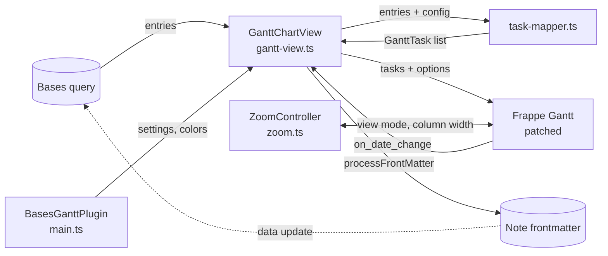

# Bases Gantt docs

These docs are organized **by feature: one page per feature**. Each page briefly says what the feature does, then how it is built: which components are involved and how they work together. This page gives the overall architecture the feature pages build on.

## Features

- [Task mapping](task-mapping.md): notes → bars, auto-detection, dependencies
- [Zoom](zoom.md): continuous zoom, persisted per device
- [Dragging](dragging.md): moving and resizing bars, snapping, dependents, undo
- [Progress](progress.md): progress from numbers or formulas, optional editing
- [Open-ended tasks](open-ended-tasks.md): tasks without an end date
- [Planned start](planned-start.md): projects picked up again later
- [Colors](colors.md): stable automatic colors and fixed value colors
- [Hover popup](hover-popup.md): details, properties and note preview
- [Settings](settings.md): plugin settings and view options
- [Commands and menus](commands-and-menus.md): command palette, context menus, click-to-create

## Architecture

Bases Gantt is an Obsidian Bases view. Bases runs the query and hands the view its entries (notes). The plugin turns them into tasks, draws them with [Frappe Gantt](https://github.com/frappe/gantt), and writes drags back into the notes' frontmatter.

### Modules

| File | Role |
|---|---|
| `main.ts` | Registers the view, commands and settings tab. Owns plugin settings and color assignments. |
| `gantt-view.ts` | The view: render lifecycle, Frappe options and patches, drags, popup, menus. |
| `task-mapper.ts` | Pure mapping of Bases entries to Frappe tasks: dates, dependencies, colors, ordering. |
| `zoom.ts` | Continuous zoom on top of Frappe's fixed view modes, date ↔ x math, and keeping renders cheap (grid window, weekend shading, header labels). |
| `colors.ts` | Bar shades resolved per color, and which palette colors resemble the user's fixed colors. |
| `settings.ts` | Settings schema, defaults and the settings tab. |
| `date-utils.ts` | Parsing Obsidian date values and formatting frontmatter dates. |

### Render lifecycle

`onDataUpdated()` runs whenever Bases has new data or the view config changes:

1. `getTaskMapperConfig()` resolves the properties (configured or auto-detected).
2. `mapEntriesToTasks()` builds the tasks, per group when the base is grouped.
3. If the config snapshot is unchanged, the chart is refreshed in place, keeping the scroll position. Otherwise it is rebuilt (`initGantt`).
4. `afterRender()` finishes what Frappe draws: it removes Frappe's bar grow animations and adds the quarter backdrop, milestone classes and original-start lines.

Rebuilds are skipped while a bar is being dragged and run once it ends.

### Patching Frappe

Frappe has few extension points, so behavior is changed by replacing methods:

- **Prototype** (once): transitive dependency lookup, bar date math (`compute_start_end_date`), grid date range and window (`setup_dates`), weekend shading (`highlight_holidays`).
- **Per chart instance**: drag snapping (`get_snap_position`) and popup behavior (`show_popup`, `popup.hide`).

### Where state lives

| State | Stored in | Why |
|---|---|---|
| Task data | Note frontmatter | It's the user's data; Bases reads it back. |
| Properties, display toggles | View config in the `.base` file | Per view, shared via sync. |
| Scroll position, zoom | Local storage, keyed by base path and view name | Per device, changes constantly; keeps the `.base` file out of git noise. |
| Plugin settings, color assignments | Plugin `data.json` | Global to the vault. |
