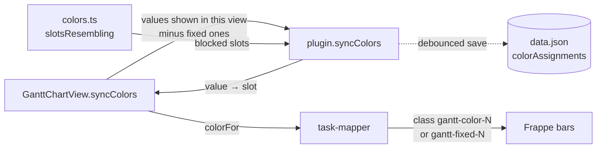

# Colors

With **Color by** set, each value of that property gets its own color. Colors stay stable as values come and go, and specific values can be given a fixed color. When Color by isn't set, a text property named like `status`, `priority`, `type`, `category`, `phase` or `stage` is used ([Task mapping](task-mapping.md)). Without one, every bar uses the theme's accent color.

## Rules

1. **Fixed color** (plugin setting **Value colors**, matched ignoring case) wins.
2. Otherwise the value keeps the **palette slot** (8 theme colors) it already has.
3. A new value gets the **lowest least-used slot**, skipping slots that look like a fixed color.
4. A value that no longer appears in the view **frees its slot**.

## How

- **Scope:** assignments are stored per view and property (`<base path>::<view name>::note.status`), so two bases with the same property don't free each other's colors.
- **Similar colors:** `slotsResembling()` resolves the theme's `--color-*` variables and the fixed colors to hues. A slot within 30° of a fixed color is blocked. If every slot is blocked, all are allowed again.
- **Drawing:** every color is a CSS class that Frappe puts on the bar when it creates it: `gantt-color-N` for palette slots, `gantt-fixed-N` for "Value colors" entries (rules generated per view). Shades set on bars afterwards were lost on iOS while pinch-zooming re-rendered the chart. Each hue is brought to one lightness so white labels stay readable. `barShades()` resolves these shades to plain colors once per color and theme (again on `css-change`). Bars without a color use `--interactive-accent` as is.
