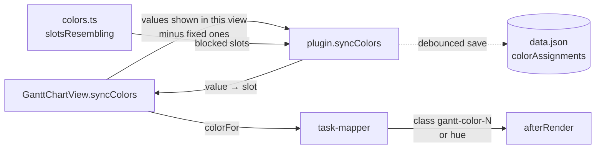

# Colors

With **Color by** set, each value of that property gets its own color. Colors stay stable as values come and go, and specific values can be given a fixed color. Without Color by, every bar uses the theme's accent color.

## Rules

1. **Fixed color** (plugin setting **Value colors**, matched ignoring case) wins.
2. Otherwise the value keeps the **palette slot** (8 theme colors) it already has.
3. A new value gets the **lowest least-used slot**, skipping slots that look like a fixed color.
4. A value that no longer appears in the view **frees its slot**.

## How

- **Scope:** assignments are stored per view and property (`<base path>::<view name>::note.status`), so two bases with the same property don't free each other's colors.
- **Similar colors:** `slotsResembling()` resolves the theme's `--color-*` variables and the fixed colors to hues. A slot within 30° of a fixed color is blocked. If every slot is blocked, all are allowed again.
- **Drawing:** a palette slot is a CSS class (`gantt-color-N`). A fixed color sets `--gantt-hue` inline on the bar (Frappe allows only one class). Both go through the same CSS formula, which sets one lightness for every hue so white labels stay readable. Bars without a color use `--interactive-accent` as is.
