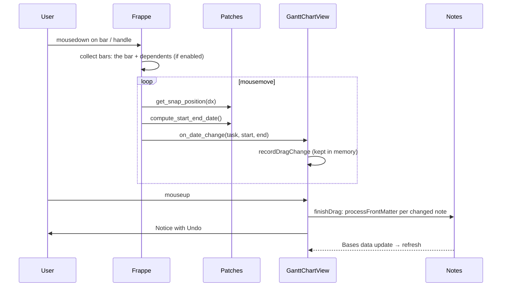

# Dragging

Drag a bar to move it, or drag its left or right edge to change its start or end. The new dates are written to the note's frontmatter, once per drag.

## Flow

While a drag is in progress (`isDragging`), data updates don't rebuild the chart, because that would jump the rows under the pointer. A skipped update runs on mouseup.

## Dates from pixels

Frappe converts a bar's absolute x back to a date by truncating units, which in Month and Year view snaps every drag to the 1st. `patchBarDateMath` replaces this: each edge's **pre-drag date is shifted by whole days** according to how far it moved (`dayShiftForX`). An edge that didn't move keeps its date, and a move keeps the length.

## Snapping

| Zoom | Step |
|---|---|
| Day columns (≥ 22 px/day) | 1 day (Frappe's own snapping) |
| Week columns and coarser | 1 week (`dragSnapDays`) |

In Month and Year view a week isn't a fixed number of pixels, because of the calendar mapping. `patchDragSnap` therefore snaps a moved start to the exact x of its new date (`xForDate`), so the bar doesn't jump when it's redrawn. A resized end snaps in uniform week steps, because Frappe sizes bars with 30-day months.

## Dependent tasks

Frappe's `get_all_dependent_tasks` only finds direct dependents, so it is patched to walk the whole chain. Whether dependents move along at all is the plugin setting **Move dependent tasks along** (`options.move_dependencies`), applied to open charts without a rebuild.

## Undo

One drag, including its dependents, is one undo batch holding each note's previous values. Undo is available from the Notice and the **Undo last change** command, up to 20 deep (`MAX_UNDO_ENTRIES`).

## What gets written

- **Start:** the start property, or the planned start if the bar begins there ([Planned start](planned-start.md)).
- **End:** only if the note has one, or if the bar was resized ([Open-ended tasks](open-ended-tasks.md)).
- Computed properties (`file.*`, `formula.*`) are never written.
