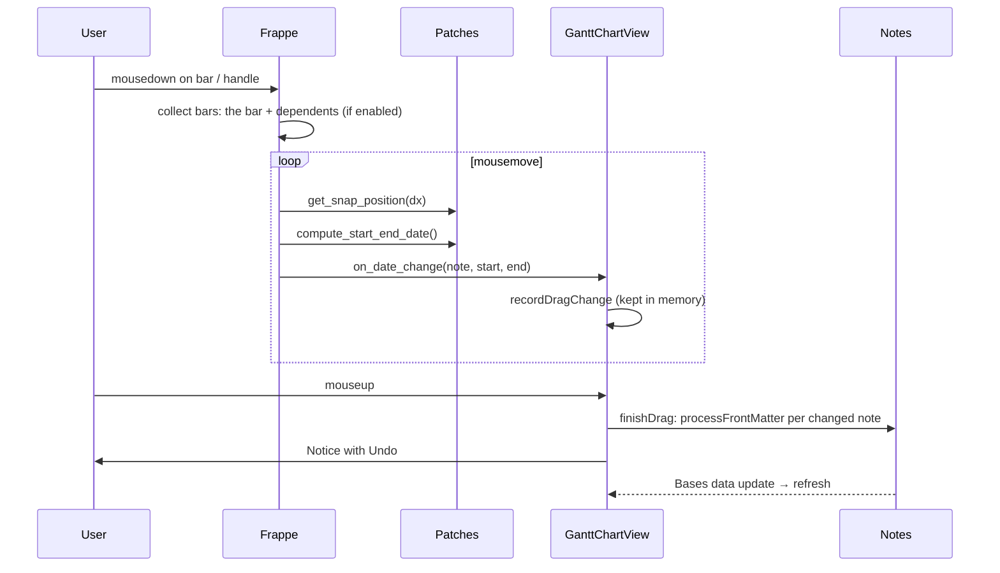

# Dragging

Drag a bar to move it, or drag its left or right edge to change its start or end. The new dates are written to the note's frontmatter, once per drag. Progress can be dragged too, when the view allows it ([Progress](progress.md)).

## Flow

While a drag is in progress (`isDragging`), data updates don't rebuild the chart, because that would jump the rows under the pointer. A skipped update runs on mouseup.

## Dates from pixels

Frappe converts a bar's absolute x back to a date by truncating units, which in Month and Year view snaps every drag to the 1st. `patchBarDateMath` replaces this: each edge's **pre-drag date is shifted by whole days** according to how far it moved (`dayShiftForX`). An edge that didn't move keeps its date, and a move keeps the length.

## Minimum length

A resized edge can't cross the other one. `compute_start_end_date` passes the new dates through `keepOneDay()` (`date-utils.ts`), which stops the dragged edge where the bar is one day long. Without it a one-day bar could have its end dragged to the day before its start, and at week snapping a short bar's end jumped back a whole week. A clamped drag sets `dragWasClamped`; if nothing ends up written, the mouseup handler redraws the chart so the bar doesn't stay as short as the pointer left it.

## Snapping

| Zoom | Step |
|---|---|
| Day columns (≥ 22 px/day) | 1 day (Frappe's own snapping) |
| Week columns and coarser | 1 week (`dragSnapDays`) |

In Month and Year view a week isn't a fixed number of pixels, because of the calendar mapping. `patchDragSnap` therefore snaps a moved start to the exact x of its new date (`xForDate`), so the bar doesn't jump when it's redrawn. A resized end snaps in uniform week steps, because Frappe sizes bars with 30-day months.

## Dependent notes

Frappe's `get_all_dependent_tasks` only finds direct dependents, so it is patched to walk the whole chain. Whether dependents move along at all is the plugin setting **Move dependent notes along** (`options.move_dependencies`), off by default and applied to open charts without a rebuild.

## Undo

One drag, including its dependents, is one undo batch holding each note's previous values. Undo is available from the Notice and the **Undo last change** command, up to 20 deep (`MAX_UNDO_ENTRIES`). [Progress](progress.md) edits go on the same stack.

- **Collecting:** Frappe fires `on_date_change` on every day boundary crossed, so `recordDragChange()` keeps the first previous values and the latest new values per note. `finishDrag()` writes them once, on mouseup.
- **No-op drags:** a note whose new values equal its previous ones (dragged out and back) is dropped. If nothing is left, nothing is written and no Notice appears.
- **Notice:** shown for 6 seconds with an **Undo** button, e.g. `Moved "Design" (+2 dependent)`. Undoing shows `Undid: …`, or `Nothing to undo.` on an empty stack.
- The stack lives in the open view: it is lost when the view closes.

## Clicks vs. drags

Frappe fires a click on a bar after any release, including a drag that snapped back without changing a date. The view records the mousedown position, and a release more than 4 px away (`CLICK_SLOP_PX`) counts as a drag, so it doesn't open the note. Pressing a bar also cancels a [hover popup](hover-popup.md) about to show.

## What gets written

- **Start:** the start property, or the planned start if the bar begins there ([Planned start](planned-start.md)).
- **End:** only if the note has one, or if the bar was resized ([Open-ended notes](open-ended-notes.md)).
- Computed properties (`file.*`, `formula.*`) are never written.
