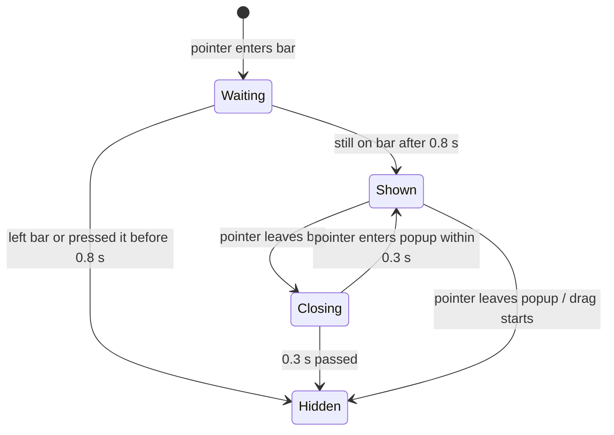

# Hover popup

When enabled (view option **Show details on hover**, off by default), resting on a bar for 0.8 s shows a popup with dates, duration, original start, progress, dependencies, chosen properties and a read-only, scrollable preview of the note. A click on it opens the note.

## Content

`renderPopup()` fills Frappe's popup (title, subtitle, details). Then `renderPopupPreview()` adds the note preview asynchronously:

- **Properties:** plugin setting **Properties on hover**, read from the note's frontmatter cache. Missing ones are left out, and `[[links]]` show their name or alias.
- **Preview:** plugin setting **Note preview on hover**. The body without frontmatter is rendered with `MarkdownRenderer`, up to 5000 characters. The bottom fades until it's scrolled to the end.
- **Stale previews:** `popupTaskId` tracks the bar the popup is for. A preview that finishes after the pointer moved to another bar is dropped.

## Behavior (`patchPopup`)

- **Delay:** Frappe's 200 ms plus 600 ms, so the popup doesn't get in the way of dragging.
- **Placement:** `fitPopup()` moves it up or left until it is fully inside the visible chart. It runs again after the preview has loaded. Its z-index is above the sticky date header.
- **Read-only:** a capture-phase click handler on the chart stops every click inside the popup (checkboxes and links included) and opens the note instead.

## Switches

- View option **Show details on hover** (off by default): checked on every hover, returning `false` to Frappe, so no rebuild is needed.
- Plugin settings **Properties on hover** and **Note preview on hover**.
