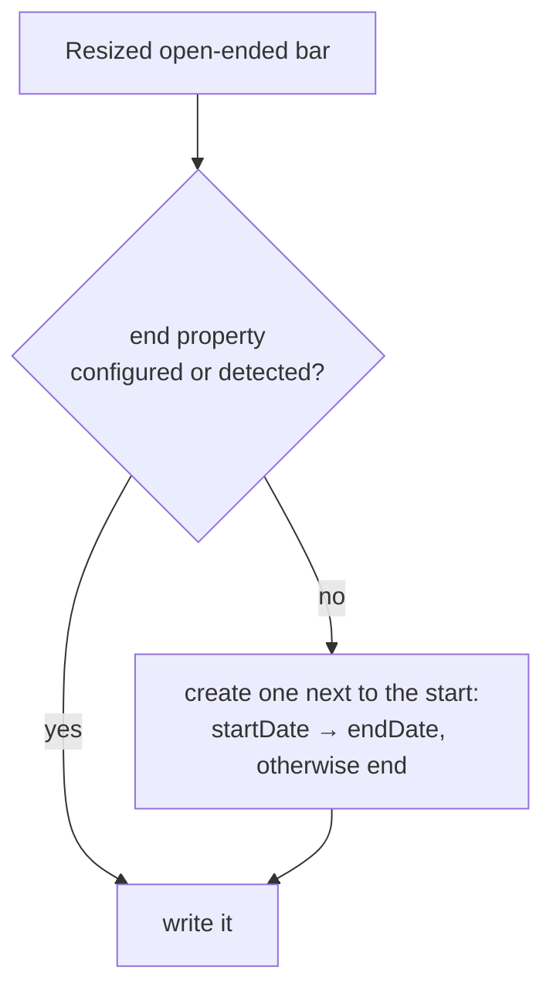

# Open-ended tasks

A note with a start date but no end date is still drawn, with a default length. Moving it keeps it open-ended. Resizing its right edge gives it a real end date.

## How

- **Drawing** (`task-mapper.ts`): with no end, `end = start + defaultDurationDays` (plugin setting, default 91), and `hasEnd = false`. It's a fixed day count rather than calendar months, so the bar's length doesn't change when it's moved.
- **Moving** (`on_date_change`): only the start is written while `hasEnd` is false and the length is unchanged.
- **Resizing:** a changed length counts as resized, so the end is written too.

## Where the end goes

The end property is auto-detected even when only the start is configured, and an end property that is empty in every note is still found by name. Only when no note has one at all does `newEndProperty()` derive a name from the start property.
