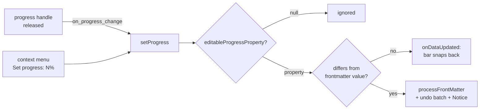

# Progress

With **Show progress** on, each bar is filled to the note's completion percentage. Progress can come from a number in the note or from a formula, for example one counting the note's checked tasks. A number can be edited on the chart; a formula is always read-only.

## Sources

| Progress property | Example | Editable on the chart |
|---|---|---|
| Number in the note | `progress: 40` | unless **Drag to set progress** is off |
| Formula | `if(tasks > 0, tasks_completed / tasks * 100, 0)` | never |

The formula example uses the [Task Count](https://github.com/anareaty/task-count) plugin, which writes `tasks` and `tasks_completed` into notes that have those properties. The README has the full setup.

## View options

| Option | Effect |
|---|---|
| Show progress | Draws the fill. Unset, it turns on by itself once a progress property is found. |
| Progress | The property. Unset, a number property named like `progress`, `percent` or `done` is detected, only when the start isn't configured either ([Task mapping](task-mapping.md)). |
| Show expected progress | Frappe's dashed marker for how far along the task should be by today. |
| Drag to set progress | On by default, as in the original plugin. Shows the progress handle and the **Set progress** menu items. Turn it off when another tool owns the number. |

Show expected progress and Drag to set progress are hidden while Show progress is off.

## Mapping

`mapEntriesToTasks()` parses the value as a number and clamps it to 0–100. Anything else (missing, text, a formula dividing by zero to `NaN`) is 0. A division by zero to `Infinity` clamps to 100, which is why the formula above checks `tasks > 0`.

The [hover popup](hover-popup.md) shows the same value as a small bar with its percentage.

## Editing

- **When it's editable:** `editableProgressProperty()` returns the frontmatter key only when **Drag to set progress** isn't turned off, progress is shown, and the property is a note property. `file.*` and `formula.*` can't be written, so a computed progress stays read-only even with the option on.
- **Handle:** Frappe draws it only when `readonly_progress` is false, and reads that option when it draws the bars. Drag to set progress is therefore part of the config snapshot, so toggling it rebuilds the chart.
- **Previous value:** Frappe works on the view's task objects and has already set `task.progress` to the new value when `on_progress_change` fires. The previous value is read from the note's frontmatter cache instead, which is also what Undo writes back (0 if the note had none).
- **Undo:** each change is its own undo batch, shared with drags: the Notice's **Undo** button and the **Undo last change** command ([Dragging](dragging.md)).
- **No lag:** `.bar-progress` has no CSS `width` transition. Frappe sets the width on every mousemove, and restarting a transition each time made the fill trail the pointer.
