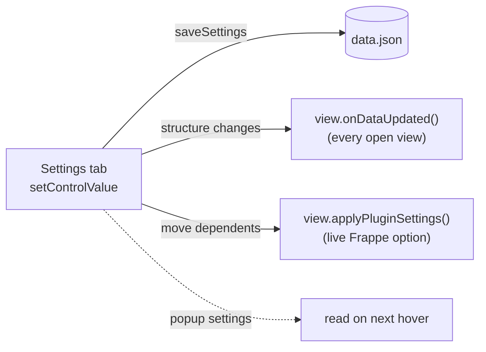

# Settings

There are two levels: **view options**, per Gantt view in a base, and **plugin settings**, for the whole vault.

A topic is configured in one place. The view holds which properties feed the chart and how it looks per base. Everything about the hover popup is in the plugin settings (**Hover** group), and **Value colors** there only maps values to colors for the view's **Color by** property.

## View options (Configure view)

Defined in `getGanttViewOptions()` and stored by Bases in the `.base` file.

| Group | Option |
|---|---|
| Properties | Start date, End date, Label, Dependencies, Color by, Progress |
| Display | Bar height, Show progress, Drag to set progress |
| Advanced | Planned start, Show original start (on by default) |

A change triggers `onDataUpdated()`. Options that affect the chart's structure are part of the config snapshot and rebuild it. The rest are read on each render or hover.

## Plugin settings (Settings → Community plugins)

Defined in `settings.ts` (`GanttForBasesSettings`, `GanttForBasesSettingTab`) and stored in the plugin's `data.json`. The tab is declarative (`getSettingDefinitions()`, Obsidian 1.13), so its settings appear in Obsidian's settings search. `getControlValue` / `setControlValue` convert **Properties on hover** between its stored list and the comma-separated text field, and apply changes to open views. **Value colors** is a list with add and delete controls; each row renders its color picker and value field.

| Setting | Used by |
|---|---|
| Move dependent notes along | [Dragging](dragging.md) |
| Default length without end date | [Open-ended notes](open-ended-notes.md) |
| Hover group: Show details on hover, Properties on hover, Note preview on hover | [Hover popup](hover-popup.md) |
| Value colors | [Colors](colors.md) |
| *(hidden)* color assignments | [Colors](colors.md) |

## Applying changes

Open views are reached through the static `GanttChartView.instances`. `loadSettings()` copies the nested objects, so changing settings never changes `DEFAULT_SETTINGS`.
