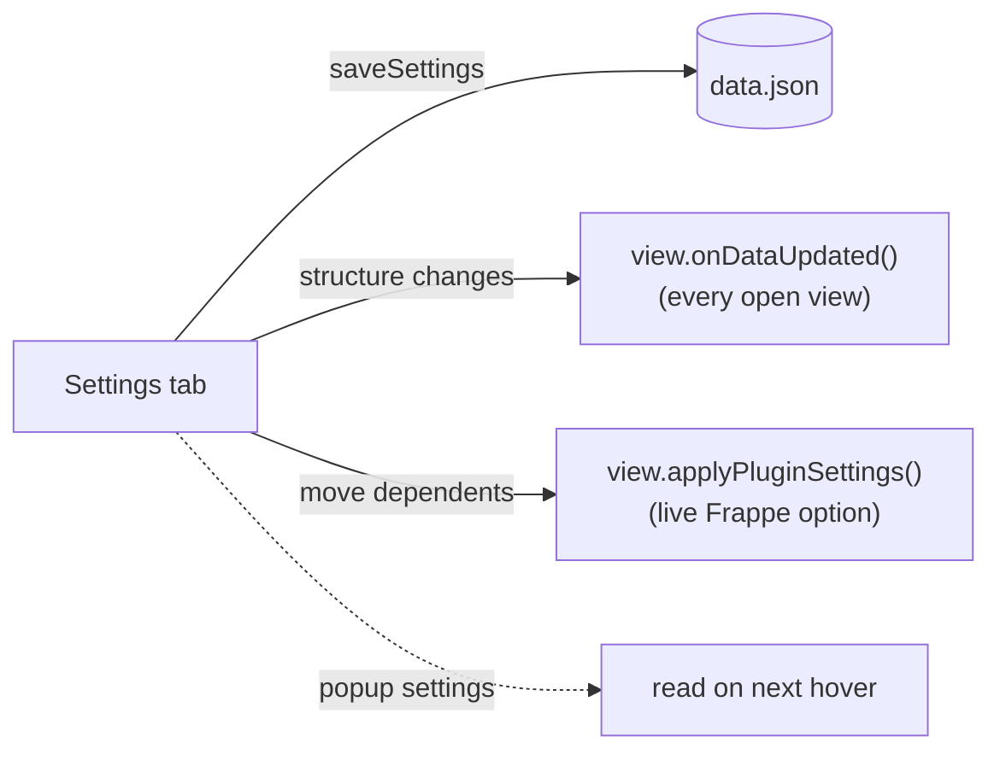

# Settings

There are two levels: **view options**, per Gantt view in a base, and **plugin settings**, for the whole vault.

## View options (Configure view)

Defined in `getGanttViewOptions()` and stored by Bases in the `.base` file.

| Group | Option |
|---|---|
| Properties | Start date, Planned start, End date, Label, Dependencies, Color by, Progress |
| Display | Bar height, Show progress, Show expected progress, Drag to set progress, Show original start, Show details on hover |

A change triggers `onDataUpdated()`. Options that affect the chart's structure are part of the config snapshot and rebuild it. The rest are read on each render or hover.

## Plugin settings (Settings → Community plugins)

Defined in `settings.ts` (`BasesGanttSettings`, `BasesGanttSettingTab`) and stored in the plugin's `data.json`.

| Setting | Used by |
|---|---|
| Move dependent tasks along | [Dragging](dragging.md) |
| Default length without end date | [Open-ended tasks](open-ended-tasks.md) |
| Properties on hover, Note preview on hover | [Hover popup](hover-popup.md) |
| Value colors | [Colors](colors.md) |
| *(hidden)* color assignments | [Colors](colors.md) |

## Applying changes

Open views are reached through the static `GanttChartView.instances`. `loadSettings()` copies the nested objects, so changing settings never changes `DEFAULT_SETTINGS`.
