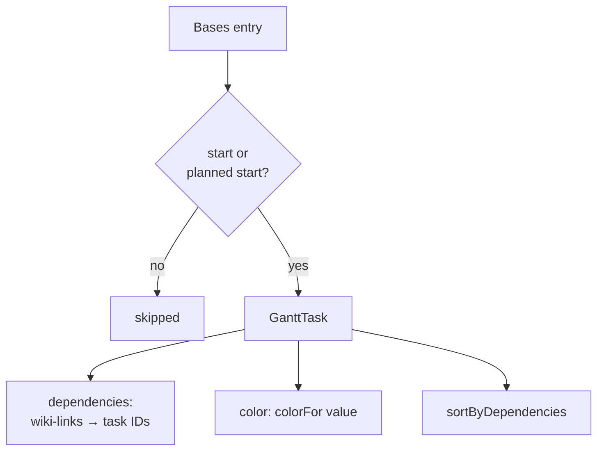

# Task mapping

Each note in the base becomes one bar. Its start, end, label, dependencies, progress and color come from note properties.

## Resolving properties

`GanttChartView.getTaskMapperConfig()` uses the properties set under **Configure view → Properties**. Unset ones are auto-detected (`autoDetectProperties()`). Each property is classified as date, number or text by the first note that has a value for it, then matched by name (case, `-` and `_` ignored; the first property containing a keyword wins):

| Role | Candidates | Keywords | Fallback |
|---|---|---|---|
| Start | date properties | `start`, `begin`, `from`, `created` | the first date property |
| End | date properties | `end`, `due`, `finish`, `deadline`, `until` | the next date property after the start |
| Dependencies | text properties | `depend`, `block`, `after`, `prerequisite`, `requires` | none |
| Progress | number properties | `progress`, `percent`, `completion`, `complete`, `done` | none |
| Color by | text properties | `status`, `priority`, `type`, `category`, `phase`, `stage` | none |

- **Configured always wins.** A detected property only fills an option that is unset.
- **Start and end:** detected whenever either is unset. The end is never the configured start. An end property that is empty in every note is still found if its name looks like a date (contains `date` or starts with an end keyword), so e.g. an empty `attendees` isn't taken for it. `file.*` dates (read-only) and the planned start are never used.
- **Dependencies, progress, Color by:** only detected when the start isn't configured either, so a hand-configured view isn't changed behind the user's back.
- **Show progress:** if the option was never set, it turns on by itself once a progress property is found ([Progress](progress.md)).
- **Planned start:** never guessed by keyword, only a property named `plannedStart` ([Planned start](planned-start.md)).

## Mapping

`mapEntriesToTasks(entries, config, colorFor)` in `task-mapper.ts` is pure: entries in, `GanttTask[]` out.

- **Dates** are parsed by `parseObsidianDate()` (`date-utils.ts`): `YYYY-MM-DD` as local midnight (so a date doesn't shift a day in other time zones), `YYYY-MM-DD HH:MM`, ISO datetimes and timestamps. A note whose start can't be read is skipped. An end before the start is drawn one day long (`end = start`). Frappe's `_end` is the midnight after the last day, so the hover popup shows the day before it (`taskDaySpan()`).
- **IDs** come from the file path, encoded to be CSS-safe (`Notes/A.md` → `Notes_2f_A_2e_md`). Frappe uses them in class names and in comma-separated dependency lists.
- **Dependencies:** `[[links]]` (aliases allowed) or, without any `[[`, plain comma-separated names resolve to IDs by basename or by path without extension. Links to notes that aren't on the chart are dropped. Frappe draws an arrow from each prerequisite to the task.
- **Order:** by start date, but every task comes after the tasks it depends on, so arrows point down. With circular dependencies, the tasks in the cycle are appended by start date.
- **Labels:** the **Label** property, or the file name when unset or blank. They are HTML-escaped (`name`), because Frappe writes them with `innerHTML`. `label` keeps the plain text. On the chart a label sits inside its bar in white, or beside the bar when it doesn't fit (Frappe's `auto_move_label`).

## One-day tasks

A task whose end equals its start is drawn one day long: Frappe counts a date-only end as a full day, so `end = start` needs no padding. It looks like any other bar; there is no special milestone styling.

## Grouping

When the base is grouped, each group is mapped on its own and preceded by a header task (`__group__N`) spanning the group's dates. The header shows the group's value, or "Ungrouped" for notes without one, as a muted outlined row (`.gantt-group-header`). Empty groups are left out. Since each group is mapped with only its own notes, dependencies resolve and order tasks within a group: a link to a note in another group draws no arrow. Header tasks are skipped by drags, clicks, context menus and the popup.

## Empty state

Without any task to draw, the chart is replaced by a hint (`renderEmptyState()`): "Configure a start date property" when no start could be resolved, otherwise "No tasks with valid dates found". If Frappe fails to build the chart, the error is logged and the same hint is shown.
