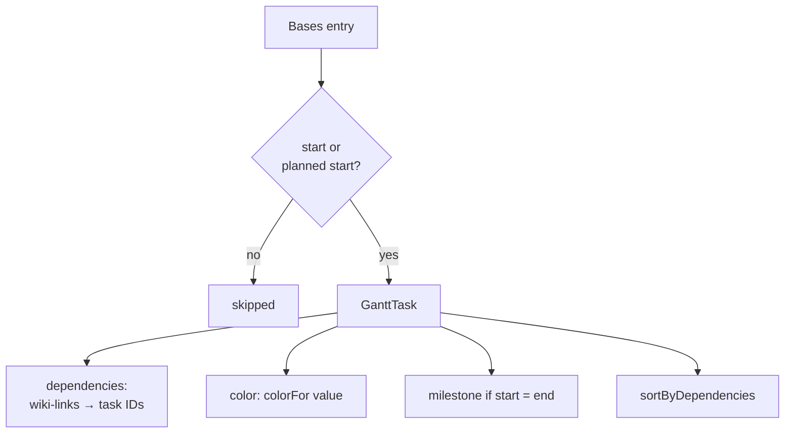

# Task mapping

Each note in the base becomes one bar. Its start, end, label, dependencies, progress and color come from note properties.

## Resolving properties

`GanttChartView.getTaskMapperConfig()` uses the properties set under **Configure view → Properties**. Unset ones are auto-detected by name (`autoDetectProperties()`):

- **Start / end:** date properties whose names contain `start`, `end`, `due`, … Otherwise the first and second date properties. An end property that is empty in every note is still found by name. `file.*` dates and the planned start are never used.
- **Dependencies, progress:** by keyword, only when the start isn't configured either.
- **Color by, planned start:** never guessed by keyword (see [Colors](colors.md) and [Planned start](planned-start.md)).

## Mapping

`mapEntriesToTasks(entries, config, colorFor)` in `task-mapper.ts` is pure: entries in, `GanttTask[]` out.

- **IDs** come from the file path, encoded to be CSS-safe (`Notes/A.md` → `Notes_2f_A_2e_md`). Frappe uses them in class names and in comma-separated dependency lists.
- **Dependencies:** `[[links]]` (or plain comma-separated names) resolve to IDs by basename or path.
- **Order:** by start date, but every task comes after the tasks it depends on, so arrows point down.
- **Labels** are HTML-escaped (`name`), because Frappe writes them with `innerHTML`. `label` keeps the plain text.

## Grouping

When the base is grouped, each group is mapped on its own and preceded by a header task (`__group__N`) spanning the group's dates. Header tasks are skipped by drags, clicks and the popup.
