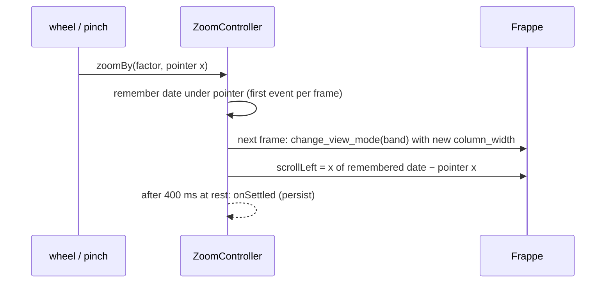

# Zoom

Pinch, Ctrl/Cmd + scroll, or the zoom commands change one continuous value: **pixels per day**. Frappe only knows fixed view modes, so `ZoomController` (`zoom.ts`) maps each zoom level to a mode.

## Bands

| px/day | Frappe mode | Column |
|---|---|---|
| < 1 | Year | 365 days |
| 1–4 | Month | 30 days |
| 4–22 | Week | 7 days |
| 22–80 | Day | 1 day |
| ≥ 80 | Half / Quarter Day | 12 h / 6 h |

`column_width = pxPerDay × days per column`, so crossing a band only swaps grid lines and header labels. Bars stay where they were.

## Rendering a zoom step

Events are batched to one render per animation frame. The date under the pointer is kept in place.

## Date ↔ x

`xForDate()` and `dateForX()` mirror Frappe's own mapping. It is uniform for day units, but calendar-based in Month and Year (day D of a month at D/31 of its column). [Dragging](dragging.md) relies on these to place bars exactly.

## Other adjustments

- **Grid range** (`setup_dates` patch): padded by at least one viewport width on each side, and Week columns start on Monday.
- **Speed:** each zoom step re-renders the whole chart, so per-day and per-column work is kept small:
  - Renders run with cached `Intl.DateTimeFormat` instances (`withCachedDateFormats`). Frappe would otherwise create two per header label.
  - `highlight_holidays` is replaced: one rect per weekend (from Week zoom on), one transparent click target for the whole grid, and one day-hover rect moved on `mousemove`. Frappe drew a rect per day of the grid range: thousands for projects spanning years.
  - Header label formats (`fittingFormat`) are measured once per zoom level, not per column.
  - The grid has at most 800 columns (`MAX_COLUMNS`). At Day zoom and finer, projects spanning years would need thousands. Beyond that only a window around the view is drawn, centered by `renderAnchored` / `withRenderCenter`. `extendWindow()` redraws it around the view when scrolling gets within a viewport of a cut edge (not during a drag).
  - While a zoom gesture is under way, only about 5 viewport widths are drawn (`GESTURE_VIEWPORTS`). The full window follows once no zoom event came for 150 ms.
  - Frappe's grow-from-zero SMIL animation on bars is removed after every render (`afterRender`). Otherwise bars collapsed and regrew whenever a zoom gesture paused.
- **Today:** `scrollToToday()` replaces Frappe's version, which fails on iOS and when today is outside the grid.

## Persistence

Zoom and scroll position are saved per device in local storage, keyed by `<base path>::<view name>`. A `zoom` value in the view config is only read, as the default for devices without saved state.
